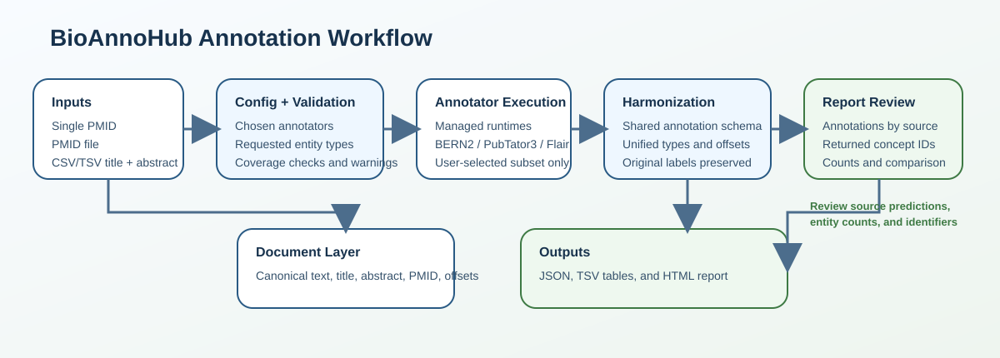

# Annotation workflow



BioAnnoHub loads documents, runs selected annotators, and exports their results
with source provenance. Use the interactive terminal workflow for a new run or
save a TOML configuration for repeated use.

## Interactive run

```bash
uv run bioannohub annotate
```

1. Choose PMID input, a PMID file, or plain text.
2. For plain text, choose a CSV/TSV table, a raw text file, or terminal entry.
3. Filter the available annotators by domain and supported task.
4. Select annotators and entity types, then review the run plan.
5. Press Enter to run, or use `restart` or `exit` during setup.
6. Inspect the terminal summary and the saved JSON, TSV, and HTML outputs.

Domain and task choices filter the available tools. They do not change an
annotator's model or restrict its predictions to NER or NEN. Choosing NEN-capable
or all tasks enables Flair's linkers when Flair is selected. Entity-type filters
apply to the combined predictions after execution.

Optional local models require their corresponding extras, model downloads, or
external setup. Some tools call remote services. An unavailable annotator is
reported in the results; review its status before interpreting an empty result.

## Config-based run

```bash
uv run bioannohub inspect-config --config configs/examples/pmid-single.toml
uv run bioannohub load-documents --config configs/examples/pmid-single.toml
uv run bioannohub run-config --config configs/examples/pmid-single.toml
```

`inspect-config` validates and displays the configuration without fetching
articles or running annotators. `load-documents` previews the input documents;
PMID inputs require network access. `run-config` executes the selected tools and
writes outputs when `[output].path` is configured.

Relative paths in configurations resolve from the working directory. Run the
repository examples from the repository root.

## Input formats

| Mode | Configuration | Content |
| --- | --- | --- |
| `pmids` | `input.pmids` | List of PubMed IDs |
| `pmid_file` | `input.pmid_file` | One PubMed ID per nonempty line |
| `text_table` | `input.text_file`, `input.format` | CSV/TSV with `document_id`, `title`, and `abstract` columns; column names are configurable |
| `corpus` | `input.corpus_path` | JSON list of document objects or an object with a `documents` list |

PMID inputs use PubTator3 for fetching by default. Entrez, Europe PMC, multi-source
fetching, and field selection are configured separately from annotation. PubTator3
annotation requires a PubMed/PMC identifier; select another compatible annotator
for user-supplied plain text.

Search PubMed before a batch run with:

```bash
uv run bioannohub search-pmids \
  --query 'glioblastoma AND microRNA' \
  --output data/inputs/query_pmids.txt
```

See the [search guide](../src/bio_annotation/io/README.md) for date bounds and
filters, and the [configuration guide](../configs/README.md) for examples.

## Annotation contracts

A document stores its identifier, title, abstract, optional full text, source,
and metadata. Its canonical annotation text joins the title and available body
with a blank line. Each annotation retains its source, mention text, mapped
entity type, offsets, and any identifiers or scores returned by the annotator.
Offsets use an inclusive start and exclusive end.

Entity-type mapping does not make every tool's label set equivalent. Inspect the
[annotator capabilities](../README.md#annotators-and-supported-entity-types) when
selecting tools. Identifiers remain those returned by each annotator; the runner
does not provide cross-database identifier reconciliation or a calibrated
consensus confidence score.

## Saved run

Interactive runs are saved under `outputs/runs/`. Config-based runs use the
parent directory of `[output].path`. Every run receives a timestamped directory;
if another run already uses that timestamp, a numeric suffix keeps them separate.

| File | Purpose |
| --- | --- |
| `config.toml` | Saved configuration referencing copied file inputs |
| `inputs/` | Copied input files, or a PMID list for inline PMID input |
| `results/<name>.json` | Documents, annotations, keyword groups, and execution statuses |
| `results/<name>.annotations.tsv` | Per-annotation review table |
| `results/<name>.keywords.tsv` | Keyword summary table |
| `results/<name>.html` | Interactive annotation report |
| `run_manifest.json` | Run metadata, execution summary, and output paths |

The output filename comes from the configured JSON filename; interactive runs use
`results.json`. A `latest` symlink is updated where the operating system permits
it. A failed symlink update does not discard the completed run.

Copied file inputs make a saved run reusable on the same filesystem. Remote
responses and model versions can change, so replaying a configuration does not
guarantee identical predictions.

## Local verification

```bash
uv run bioannohub demo
uv run pytest -m 'not integration'
```

The demo uses supplied example responses and needs no network or optional models.
Integration tests and real annotation runs require their external services or
model environments. `Workflow_longterm.md` is a separate research roadmap, not
the contract of the current command-line workflow.
